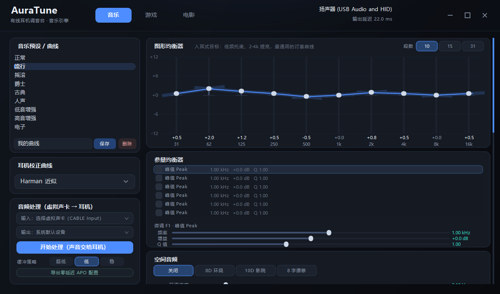
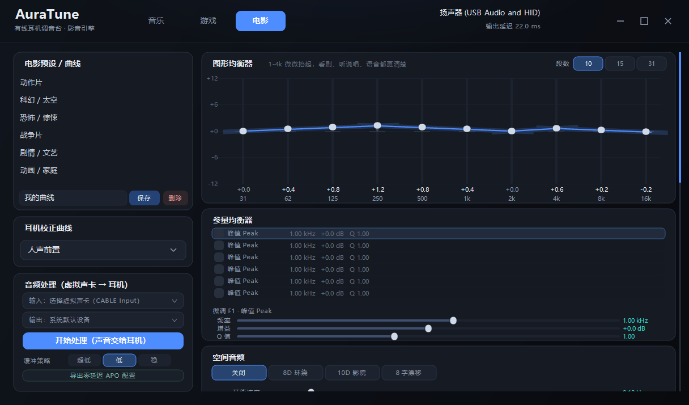
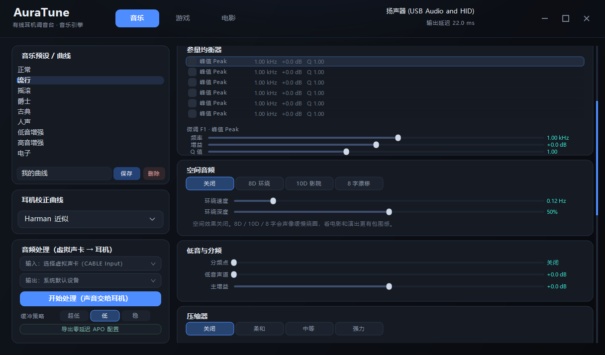

# AuraTune 耳机调音台

面向**有线耳机**的 Windows 桌面调音软件：把耳机当作可以被"重新校准"的监听设备，用实时 DSP 修掉耳机的短板，让二游 / FPS 能听清脚步、让 R&B / 摇滚 / 华语流行更好听。

纯 C++17 + Win32 + GDI+ + WASAPI + Media Foundation，**零第三方依赖**，单文件 800KB 出头的绿色程序。

## 下载（直接可运行）

不想编译的话直接下发布包：

| 文件 | 说明 |
| --- | --- |
| [`AuraTune_v2.1_win64.zip`](https://github.com/chenzy0623/AuraTune/releases/download/v2.1/AuraTune_v2.1_win64.zip) | 完整包：`AuraTune.exe` + 使用说明 + 交付说明 + README + LICENSE + `apo\` 文件夹，**解压即用** |
| [`AuraTune.exe`](https://github.com/chenzy0623/AuraTune/releases/download/v2.1/AuraTune.exe) | 只想要程序本体：单文件绿色版，双击运行 |

发布页：<https://github.com/chenzy0623/AuraTune/releases/latest> · 系统要求 Windows 10 / Windows 11，64 位。








## 功能

### 三种模式，一键切换
- **音乐模式**：完整的 Enhanced EQ 级调音台，配合虚拟声卡把**任何音乐软件**的声音接进来处理后再送给耳机。
- **游戏模式**：自动把 WASAPI 缓冲压到 IAudioClient3 的最小引擎周期（约 3~10ms），预设换成 FPS / 二游 / 3A 系列。
- **电影模式**：按**电影类型**给曲线（动作 / 科幻 / 恐怖 / 战争 / 剧情 / 动画），宽声场与低频更讨喜。
- **自动切换**：后台每 2 秒扫描进程，检测到游戏（原神 / 星穹铁道 / 绝区零 / 鸣潮 / CS2 / 无畏契约 / Apex / 守望先锋 / 三角洲 / 永劫无间 / PUBG 等 18 个进程名）自动切到游戏模式。
- 三种模式**共用同一套调音工具**，模式只决定预设、默认缓冲与文案——不会出现"这个模式少个功能"。

### 界面：一条一条列在下面
右栏不再把所有控件挤在顶部，而是**每个功能区一张卡，纵向堆叠**，鼠标滚轮上下滚（右侧有滚动条）：

1. **图形均衡器** —— **10 / 15 / 31 段**可切，±12dB，拖动即生效，滚轮微调单段；31 段为 1/3 倍频程（20Hz~20kHz），切换段数时旧曲线按对数频率自动重采样。
2. **参量均衡器** —— **6 个可独立开关的滤波器**，每个可选 **8 种类型**（峰值 / 低架 / 高架 / 低通 / 高通 / 带阻 / 全通 / 带通），频率 20Hz~20kHz、增益 ±18dB、Q 0.2~10，选中任意一行在下方用三行滑块微调。
3. **空间音频** —— **8D 环绕 / 10D 影院 / 8 字漂移**（LFO + 双耳强度差 ILD + 双耳时间差 ITD ≤24 采样 + 120Hz 高通），环绕速度、环绕深度可调。
4. **低音与分频** —— **分频点**（40~300Hz，可关，LR4 24dB/oct，低频并成单声道）、低音声道增益、**主增益 Master Gain**（±12dB）。
5. **压缩器** —— 关闭 / 柔和 / 中等 / 强力（阈值 -12/-18/-24dB、比率 2:1/3.5:1/6:1、攻击 20/8/3ms）。
6. **卷积 IR** —— 载入耳机校正 WAV（自写 FFT，8192 点 overlap-add），可调干湿混合。
7. **测试信号** —— 正弦 / 粉噪 / 20Hz→20kHz 扫频，频率与电平可调，用来验证整条链路。
8. **音色塑造** —— 低音增强 / 清晰度 / 氛围感 / 声场宽度 / 动态增强 五个旋钮，外加交叉馈送与音量。
9. **实时频谱 / 电平** —— 48 条对数频谱 + 左右电平 + 增益衰减。

### 耳机校正与预设
- **耳机校正曲线**（AutoEq 思路）：关闭 / Harman 近似 / 平直监听 / 低频增强 / 高频柔化 / 人声前置；会按每个频段的对数频率**逐点叠加**到图形 EQ 上（31 段时也是平滑叠加）。
- **5 个旋钮**：低音增强、清晰度、氛围感、声场宽度、动态增强。
- **交叉馈送**（bs2b 思路）：700Hz 低通 + 可调串扰量，长时间戴耳机听歌更不容易累。
- **前瞻限幅器**：-0.6dB 天花板，63 采样前瞻，暴力低音也不炸。
- **23 套内置预设（都用常用名）+ 自定义曲线**：
  - 音乐 9 套：正常、流行、摇滚、爵士、古典、人声、低音增强、高音增强、电子。
  - 游戏 9 套：FPS 脚步、FPS 竞技、通用、二游 剧情、二游 语音、3A 剧情、3A 动作、3A 电影、3A 夜间。
  - 电影 6 套（按**电影类型**）：动作片、科幻 / 太空、恐怖 / 惊悚、战争片、剧情 / 文艺、动画 / 家庭。
- **自定义曲线**：把当前 EQ / 段数 / 参量滤波器 / 五个旋钮 / 交叉馈送 / 校正调成你喜欢的样子，点名字框起名，再点「保存」，就会以 `★ 名字` 的形式出现在列表里；「删除」移除选中的自定义曲线。全部存在 `AuraTune.ini`（UTF-16 写盘，中文不乱码），重启不丢，最多 40 条。

### 纯调音工具，不做播放器
- 本软件**没有内置播放器**：你有自己的音乐软件，AuraTune 只负责调音。
- 实时 48 条频谱 + 电平表 + 增益衰减显示（电平框按窗口高度自适应，正常窗口下就有足够高度）。
- 标题栏只保留三个按钮，按 Windows 10 习惯排列：**最小化 → 最大化 → 关闭**。
- 全屏用 **F11 / Alt+Enter**（Esc 或再按 F11 退出），最大化与全屏都按**工作区**取尺寸，**不会盖住底部任务栏**；窗口默认 16:9。
- 关窗可最小化到系统托盘（托盘菜单：显示主界面 / 切换模式 / 退出）。
- 小屏自适应布局：窗口最小 960×620，面板与控件按高度自动收缩，1366×768 也不会有按不到的按钮。
- 切模式不卡顿：ini 写入延迟合并（700ms 内的连续修改只写一次），后台缓冲按尺寸缓存，定时器只重画频谱与提示条。

## 音乐模式怎么出声（虚拟声卡路由）

Windows 上"处理别的软件的声音"有两条路，AuraTune 两条都实现了，按系统版本自动选：

1. **虚拟声卡路由（Windows 10 也能用，推荐）**
   - 装一个免费的 [VB-Audio Virtual Cable](https://vb-audio.com/Cable/)（本机测试即用它），系统里会多出 `CABLE Input` / `CABLE Output` 一对虚拟设备。
   - AuraTune 音乐模式左卡：**输入** 选 `CABLE Input`，**输出** 选你的耳机/声卡，点「开始处理音乐音频」（第一次点会自动帮你挑好这一对）。
   - 然后把你音乐软件的**输出设备**选成 `CABLE Input`（大多数播放器会记住这个选择）。
   - 声音路径：音乐软件 → CABLE Input → AuraTune 捕获 → DSP → 耳机。端到端额外延迟约 **10ms**。
2. **按进程捕获（Windows 10 build 20348 / Windows 11 才支持）**
   - 点「选择要处理的应用…」，直接挑正在放歌的进程，不需要虚拟声卡、也不需要改播放器设置。
   - 该 API（`VAD\Process_Loopback`）在 **Windows 10 22H2 (19045) 及更早版本一律返回 `0x8000000E`**，这是微软的限制，不是程序 bug：官方样例明确写了 *requires Windows 10 build 20348 or later*。

> 输入与输出不能选同一台设备（会啸叫），程序会拦下来并提示。

## 延迟参考

| 路径 | 额外延迟 | 适用 | 说明 |
| --- | --- | --- | --- |
| 音乐模式 · 虚拟声卡路由 | 约 10ms（捕获 1 周期 + 渲染 2 周期） | 听歌、看视频、二游 | 需要 VB-Audio Virtual Cable |
| 音乐模式 · 按进程捕获 | 约 10~20ms | 听歌 | 需要 Win10 20348+ / Win11 |
| 游戏模式 · 按进程捕获 | 端到端约 15~25ms | 二游、单机、非电竞 | 同上版本要求 |
| Equalizer APO 配置导出 | **0ms** | FPS 竞技 | 点「导出零延迟 APO 配置」，把 txt 放进 APO 的 config 目录；音频引擎内部处理，不经过应用层 |

游戏卡里的「缓冲策略」三档：**超低**（IAudioClient3 最小周期，延迟最低，配置差的机器可能爆音）/ **低**（默认，平衡）/ **稳**（最大抗爆音能力）。

> 实测提示：最小周期由**声卡驱动**决定。多数主板板载声卡 / HDMI 输出的 `GetSharedModeEnginePeriod`
> 会给出 128~480 帧（2.7~10ms）的最小周期，超低档能明显降延迟；但部分 USB 声卡（例如本机测试用的
> USB Audio 设备）会把 min/def/max 全部报成 480 帧，这种情况下三档完全等价，界面显示的实际延迟就是
> 设备能给的下限（本机 22ms）。想在这种设备上要 0 延迟，请走 Equalizer APO 那条路。

## 编译

需要 Windows 上的 C++17 编译器，仓库按 MSYS2 / llvm-mingw 目录写好脚本：

```bat
build.bat
```

或手动：

```bash
g++ -std=c++17 -O2 -c src/app.cpp -o build/app.o      # 其余同理
g++ -std=c++17 -O2 build/*.o -o build/AuraTune.exe -municode -mwindows ^
    -lmmdevapi -lmfplat -lmfreadwrite -lmfuuid -lole32 -lgdiplus -ldwmapi ^
    -lshell32 -luuid -lcomdlg32 -lshlwapi -lwinmm -loleaut32
```

注意：
- `-municode` 必须有，否则 `wWinMain` 链接时找不到 `WinMain`。
- MinGW 头文件里没有 `AUDIOCLIENT_ACTIVATION_PARAMS` / `PROCESS_LOOPBACK_MODE`，`audio.cpp` 里自带定义。
- `KSDATAFORMAT_SUBTYPE_IEEE_FLOAT` 在部分 MinGW 上只有声明没有定义，`audio_render.cpp` / `audio_capture.cpp` 用本地 GUID 顶替。
- **改过 `app.h` / `audio.h` 一定要全量重编**（`rm -f build/*.o`），否则不同 TU 的成员偏移不一致，会出现"界面读到 0"这类灵异问题。

## 代码结构

| 文件 | 作用 |
| --- | --- |
| `src/app.h` / `app.cpp` | 数据结构、18 套预设、6 条校正曲线、10/15/31 段频点表、自定义曲线（增删/持久化）、ini 持久化（UTF-16）、游戏进程检测、参量滤波器/压缩/空间/测试音枚举 |
| `src/dsp.h` / `dsp.cpp` | 双二阶滤波器（8 种类型）、图形 EQ、参量 EQ、低音/清晰度/氛围、LR4 分频 + 低音声道、三种压缩模式、8D/10D/8 字空间、IR 卷积（自写 FFT + overlap-add）、M/S 声场、交叉馈送、前瞻限幅 |
| `src/audio.h` / `audio.cpp` | AudioEngine 外壳：环形缓冲、渲染线程、设备回环 / 进程回环捕获、会话静音、设备枚举 |
| `src/audio_sessions.cpp` | 音频会话枚举（`ListAudioSessions`）、按 exe 找进程、播放设备枚举（`ListRenderDevices`） |
| `src/audio_render.cpp` | WASAPI 渲染：IAudioClient3 最小周期 + 事件驱动 + 指定的输出设备 + 设备热切换 + 测试音合成 + 频谱分析（FFT） |
| `src/audio_decode.cpp` | Media Foundation 解码器线程 + 线性重采样 + seek（**界面未挂播放器，保留供扩展**） |
| `src/audio_capture.cpp` | `ActivateAudioInterfaceAsync` 双模式捕获：设备回环（Win10 可用）/ 进程回环（Win10 20348+） |
| `src/ui.cpp` | 全部界面：自绘深色 UI、响应式布局、四个分页、预设/自定义曲线、设备下拉、托盘、全屏、频谱 |
| `test/*.cpp` | 自测程序：测试音生成、引擎无界面自测、DSP 断言、捕获链路、设备枚举、进程回环探针 |

## 已知限制

- **按进程捕获**需要 Windows 10 build 20348 / Windows 11；Win10 22H2 请用虚拟声卡路由。
- 音乐模式的虚拟声卡路由需要用户自己装 VB-Audio Virtual Cable（免费）；程序会自动识别，但不打包第三方驱动。
- 无法用程序切换"系统默认播放设备"（本机 Windows 不暴露 `IPolicyConfig` 接口），所以"把播放器输出改成 CABLE Input"这一步要手动做一次，之后播放器会记住。
- 捕获游戏音频时会把该游戏的原始输出静音（否则会听到两遍），退出捕获自动恢复。
- 系统独占模式（Exclusive Mode）的播放器无法被捕获。
- Equalizer APO 需要用户自己安装；软件只负责导出可直接 include 的配置文本。
- IR 卷积在混合比 100% 时首个 4096 采样（约 85ms）为静音，属 overlap-add 的正常冷启动。
- 本版本不再内置播放器（代码里仍保留 MF 解码线程，界面未挂上）。

## 更新日志

- **v2.1**：右侧功能区改成**一条一条纵向排列的卡片**（图形 / 参量 / 空间 / 低音分频 / 压缩 / IR / 测试音 / 旋钮 / 频谱），整栏滚轮滚动 + 滚动条，不再把所有控件挤在顶部；新增**电影模式**（动作 / 科幻 / 恐怖 / 战争 / 剧情 / 动画 六种电影类型曲线）；内置预设全部换成**常用名**（音乐 9 + 游戏 9 + 电影 6）；三种模式统一走「虚拟声卡进 → DSP → 耳机出」路由，切模式自动恢复；EQ 纵轴改为 `+12/+6/0/−6/−12` 独立刻度列；修正预设两行文字重叠。
- **v2.0**：音乐模式重做为 Enhanced EQ 级调音台——图形 EQ 支持 10/15/31 段、新增参量 EQ（6 个滤波器 × 8 种类型）、空间音频（8D/10D/8 字 + ILD/ITD）、LR4 分频 + 低音声道、主增益、三种压缩模式、IR 卷积（WAV 载入 + 自写 FFT）、测试音（正弦/粉噪/扫频）；音乐模式改为真实音频处理（虚拟声卡路由 / 按进程捕获双路，自动识别 VB-Audio Virtual Cable）；新增输入/输出设备选择与一键智能路由；ini 改为 UTF-16 写盘（中文不乱名）；修复进程回环激活时的堆损坏（`PropVariantClear` 误释放栈内存）。
- **v1.1**：新增自定义曲线（命名 / 保存 / 删除，ini 持久化）；新增 4 套 3A 游戏预设；移除内置播放器；标题栏只保留 Windows 10 三键，删除带文字的「全屏」按钮（F11 / Alt+Enter 仍可全屏）；电平框加高；切换模式不再卡顿；全屏 / 最大化按工作区取尺寸，露出任务栏；窗口默认 16:9，最小 960×620。
- **v1.0**：首个版本。

## 许可

MIT
