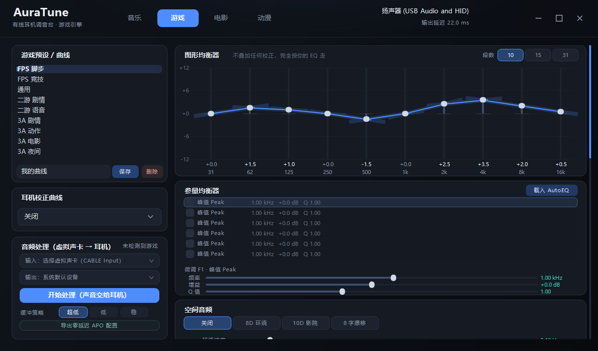

# AuraTune 耳机调音台

面向**有线耳机**的 Windows 桌面调音软件：把耳机当作可以被"重新校准"的监听设备，用实时 DSP 修掉耳机的短板，让二游 / FPS 能听清脚步、让 R&B / 摇滚 / 华语流行更好听。

纯 C++17 + Win32 + GDI+ + WASAPI + Media Foundation，**零第三方依赖**，单文件 700KB 出头的绿色程序。




## 功能

### 两种模式，一键切换
- **音乐模式**：走应用内 DSP，48kHz 浮点全链路处理，输出缓冲"低"档（约 22ms）。
- **游戏模式**：自动把 WASAPI 缓冲压到 IAudioClient3 的最小引擎周期（约 3~10ms），并关闭带拖尾的"氛围感"效果，只保留 EQ + 限幅，保证 FPS 声音不糊、不延迟。
- **自动切换**：后台每 2 秒扫描进程，检测到游戏（原神 / 星穹铁道 / 绝区零 / 鸣潮 / CS2 / 无畏契约 / Apex / 守望先锋 / 三角洲 / 永劫无间 / PUBG 等 18 个进程名）自动切到游戏模式。

### 调音部分（借鉴 FxSound / Equalizer APO+Peace / AutoEq / bs2b 的思路）
- **10 段图形均衡器**（31Hz ~ 16kHz，±12dB），拖动即生效，滚轮可微调单段。
- **5 个旋钮**：低音增强、清晰度、氛围感、声场宽度、动态增强。
- **耳机校正曲线**（AutoEq 思路）：关闭 / Harman 近似 / 平直监听 / 低频增强 / 高频柔化 / 人声前置。
- **交叉馈送**（bs2b 思路）：700Hz 低通 + 可调串扰量，长时间戴耳机听歌更不容易累。
- **前瞻限幅器**：-0.6dB 天花板，64 采样前瞻，暴力低音也不炸。
- **14 套预设**：
  - 音乐 9 套：平直还原、R&B 暖声、摇滚冲击、迈克尔·杰克逊、邓紫棋女声透亮、周杰伦华语人声、陶喆复古 R&B、女声流行向、深夜低音量。
  - 游戏 5 套：FPS 脚步定向、FPS 竞技均衡、二游沉浸、二游角色语音、通用游戏。

### 像音乐软件一样用
- 内置播放器（Media Foundation 解码）：mp3 / flac / wav / m4a / aac / wma / ogg，支持拖文件进窗口。
- 实时 48 条频谱 + 电平表 + 增益衰减显示。
- 最小化、最大化、**全屏**（按钮 / F11 / Alt+Enter / 双击标题栏），关窗可最小化到系统托盘（托盘菜单：显示主界面 / 切换模式 / 退出）。
- 小屏自适应布局：窗口最小 960×600，面板与控件按高度自动收缩，1366×768 也不会有按不到的按钮。

## 超低延迟的三条路

| 路径 | 额外延迟 | 适用 | 说明 |
| --- | --- | --- | --- |
| 音乐模式 in-app DSP | 约 5~22ms（仅渲染缓冲） | 听歌、看视频 | 默认 |
| 游戏模式进程回环 | 端到端约 15~25ms | 二游、单机、非电竞 | 无需装任何驱动，直接抓游戏进程音频处理后回放 |
| Equalizer APO 配置导出 | **0ms** | FPS 竞技 | 软件内点「导出零延迟 APO 配置」，把生成的 txt 放进 APO 的 config 目录或作为 include，音频引擎内部处理，不经过应用层 |

游戏卡里的「缓冲策略」三档：**超低**（IAudioClient3 最小周期，延迟最低，配置差的机器可能爆音）/ **低**（默认，平衡）/ **稳**（最大抗爆音能力）。

> 实测提示：最小周期由**声卡驱动**决定。多数主板板载声卡 / HDMI 输出的 `GetSharedModeEnginePeriod`
> 会给出 128~480 帧（2.7~10ms）的最小周期，超低档能明显降延迟；但部分 USB 声卡（例如本机测试用的
> USB Audio 设备）会把 min/def/max 全部报成 480 帧，这种情况下三档完全等价，界面显示的实际延迟就是
> 设备能给的下限（本机 22ms）。想在这种设备上要 0 延迟，请走 Equalizer APO 那条路。

## 编译

需要 Windows 上的 C++17 编译器，仓库按 MSYS2 / llvm-mingw 目录写好脚本：

```bat
build.bat
```

或手动：

```bash
g++ -std=c++17 -O2 -c src/app.cpp -o build/app.o      # 其余同理
g++ -std=c++17 -O2 build/*.o -o build/AuraTune.exe -municode -mwindows ^
    -lmmdevapi -lmfplat -lmfreadwrite -lmfuuid -lole32 -lgdiplus -ldwmapi ^
    -lshell32 -luuid -lcomdlg32 -lshlwapi -lwinmm -loleaut32
```

注意：
- `-municode` 必须有，否则 `wWinMain` 链接时找不到 `WinMain`。
- MinGW 头文件里没有 `AUDIOCLIENT_ACTIVATION_PARAMS` / `PROCESS_LOOPBACK_MODE`，`audio.cpp` 里自带定义。
- `KSDATAFORMAT_SUBTYPE_IEEE_FLOAT` 在部分 MinGW 上只有声明没有定义，`audio_render.cpp` / `audio_capture.cpp` 用本地 GUID 顶替。

## 代码结构

| 文件 | 作用 |
| --- | --- |
| `src/app.h` / `app.cpp` | 数据结构、14 套预设、6 条校正曲线、ini 持久化、游戏进程检测 |
| `src/dsp.h` / `dsp.cpp` | 双二阶滤波器（RBJ）、10 段 EQ、低音/清晰度/氛围、压缩器、M/S 声场、交叉馈送、前瞻限幅器 |
| `src/audio.h` / `audio.cpp` | AudioEngine 外壳：环形缓冲、播放线程、进程回环捕获、会话静音、设备枚举 |
| `src/audio_render.cpp` | WASAPI 渲染：IAudioClient3 最小周期 + 事件驱动 + 设备热切换 + 频谱分析（FFT） |
| `src/audio_decode.cpp` | Media Foundation 解码器线程 + 线性重采样 + seek |
| `src/audio_capture.cpp` | `ActivateAudioInterfaceAsync` 进程回环捕获（Windows 10 2004+） |
| `src/ui.cpp` | 全部界面：自绘深色 UI、响应式布局、托盘、全屏、均衡器曲线 |
| `test/gen_wav.cpp` | 生成测试音（1kHz / 低频 / 粉噪 / 扫频） |
| `test/engine_test.cpp` | 引擎无界面自测，打印延迟、电平、频谱 |

## 已知限制

- 进程回环捕获需要 **Windows 10 2004 (19041) 及以上**。
- 捕获游戏音频时会把该游戏的原始输出静音（否则会听到两遍），退出捕获自动恢复。
- 系统独占模式（Exclusive Mode）的播放器无法被捕获。
- Equalizer APO 需要用户自己安装；软件只负责导出可直接 include 的配置文本。

## 许可

MIT
